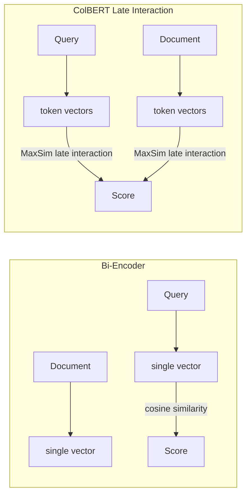

# Advanced Retrieval Strategies

In the previous section, we explored ways to optimize data storage. However, no matter how well data is organized, if the search method is inappropriate, the returned results may still be inaccurate.

In the basic RAG architecture, we rely entirely on **Vector Search**. Although powerful in capturing semantics, this method reveals weaknesses when encountering queries requiring absolute accuracy in wording, such as searching for proper names, product codes, or rare technical terms.

To overcome this, the modern strategy is to combine the power of semantic search with traditional keyword search, creating a **Hybrid Search** mechanism.

## Limitations of Vector Search and the Role of BM25

Let’s consider a simple example: A user wants to find information about `Error`` ``503`` ``Service`` ``Unavailable`.

- **Vector Search**: Tends to find paragraphs with equivalent meanings like “server overloaded”, “network connection failed”. Sometimes, it misses the exact number “503” because in vector space, these numbers may not carry much specific semantic meaning.

- **Keyword Search**: Will find exactly documents containing the character strings “Error” and “503”. This is exactly when we need keyword frequency-based search algorithms, the most representative of which is BM25.

### Best Matching 25 (BM25) Algorithm

BM25 is considered the gold standard in the field of classical information retrieval. Although Vector Search models are currently dominant, BM25 still plays an irreplaceable role in Hybrid Search systems thanks to its ability to match precise keywords.

This is a refined upgrade of TF-IDF, designed to overcome the disadvantages regarding keyword spam and document length.

**Mechanism of BM25**

BM25 scores document relevance based on 3 core statistical principles:

1.  **TF Saturation (Term Frequency Saturation)**: In TF-IDF, if a word appears more often, the score increases linearly infinitely, e.g., appearing 100 times scores 100 times higher.

     *Figure 4: Comparison of score graphs where TF-IDF increases forever, while BM25 asymptotes to a limit.*

    **BM25 Improvement**: Applies saturation mechanism. If the keyword appears a 2nd, 3rd time, the score increases significantly. But if it has already appeared 100 times, appearing the 101st time hardly adds more score, as in Figure 4. This helps prevent keyword spamming.

2.  **IDF (Inverse Document Frequency)**: Heavily penalizes common words and greatly rewards rare words. Example: In the query “symptoms of meningitis”, the word “meningitis” is many times more important than the word “of”.

3.  **Length Normalization**: This is where BM25 is much smarter. If a keyword appears once in a short paragraph, it is rated higher than appearing once in a long novel because information is diluted.

**Illustrative Example: Why need ‘Saturation’?**

Suppose a user searches for the keyword: “Galaxy”.

We have two documents:

- **Doc A**: “Galaxy Galaxy Galaxy Galaxy…” (Repeated 1000 times to spam to get to the top).

- **Doc B**: “Samsung just launched the new Galaxy phone…” (The word Galaxy appears 5 times in a reasonable context).

**Scoring**:

- **TF-IDF**: Score(A) \>\> Score(B). Doc A wins overwhelmingly because it has 1000 keywords. → Skewed result.

- **BM25**: Due to the saturation mechanism, after about 10-20 occurrences, Doc A’s score does not increase further. Meanwhile, Doc B gets bonus points thanks to reasonable document length.

→ BM25 gives a fairer assessment, eliminating the advantage of keyword spamming.

## Hybrid Search

Hybrid Search is not a new algorithm, but a process combining results from two parallel search streams: **Sparse Retriever** and **Dense Retriever**.

### Implementation Process

1.  **Parallel Execution**: When receiving a question, the system sends the query simultaneously to both search engines.

    - BM25 returns list A matching exact keywords.

    - Vector Search returns list B matching context and synonyms.

2.  **Fusion**: Merge these two lists into a single list.

3.  **Ranking**: Re-sort the priority order to produce the Top-K best documents for the LLM.

## Reciprocal Rank Fusion (RRF)

The problem when performing Hybrid Search is that the scoring scales of the two algorithms are completely different:

- **Vector Search** usually uses cosine similarity, scores are in the range \[0, 1\].

- **BM25** uses a statistical formula, scores can be any positive number.

We cannot directly add these scores together. To solve this, we use the Reciprocal Rank Fusion (RRF) algorithm.

**Principle**

Instead of caring about **scores**, RRF only cares about **rank**. It assumes that if a document appears at a high rank in both lists, it is certainly an important document. The RRF score formula for a document `\(d\)`:

\\ RRF(d) = \sum\_{r \in R} \frac{1}{k + rank_r(d)} \\

Where:

- `\(rank_i(d)\)`: Is the rank of document `\(d\)` in list `\(i\)`, starting from 1.

- `\(k\)`: Is a smoothing constant, usually chosen as `\(k = 60\)`. This constant helps reduce score disparity between very high ranks, e.g., Top 1 vs Top 2, ensuring fairness.

**Illustrative Example: Power of RRF**

Suppose constant `\(k = 60\)`. We consider two documents with different ranks in 2 search engines:

- **Doc A**: Rank 1 in Vector because very semantically correct but Rank 10 in BM25 because of missing exact keywords.

- **Doc B**: Rank 2 in Vector and Rank 3 in BM25, quite good on both sides.

**1. Calculate Score for Doc A:**

\\ Score(A) = \frac{1}{60 + 1} + \frac{1}{60 + 10} = \frac{1}{61} + \frac{1}{70} \approx 0.0164 + 0.0143 = 0.0307 \\

**2. Calculate Score for Doc B:**

\\ Score(B) = \frac{1}{60 + 2} + \frac{1}{60 + 3} = \frac{1}{62} + \frac{1}{63} \approx 0.0161 + 0.0159 = 0.0320 \\

→ **Result**: Doc B ranks above Doc A (0.0320 \> 0.0307).

Although Doc A is Top 1 in Vector Search, RRF prioritizes Doc B because it has high consensus from both algorithms. RRF helps the system choose the most harmonious document instead of just trusting one side.

| Method | Pros | Cons |
|----|----|----|
| **Vector Search** | Understands deep semantics, finds synonyms, multi-lingual. | Poor at matching exact keywords, hard to explain results. |
| **BM25** | Matches exact keywords, effective with specialized domains, fast speed. | Does not understand context, fails if user uses different synonyms than the text. |
| **Hybrid Search** | Balanced: Ensures important keywords are not missed while still understanding context. | More complex to deploy, consumes more resources due to running 2 parallel streams. |

## Modern Embedding Techniques (2025-2026) NEW

As retrieval systems mature, embedding models themselves have evolved significantly. This section covers three major advances that directly affect how you architect hybrid and dense retrieval pipelines.

### Late Interaction Models: ColBERT v2

ColBERT (Contextualized Late Interaction over BERT) is a retrieval model that represents queries and documents as sets of token-level embeddings, then scores them via **late interaction** (MaxSim). Unlike Bi-Encoders, which compress each document into a single vector, ColBERT preserves fine-grained token matching — allowing it to distinguish which parts of a document are actually relevant to each part of the query.

**How it works:**

**Notable implementations:**

- **Jina ColBERT v2**: Supports 89 languages, 8192-token context window, multi-vector matching

- **NVIDIA Nemotron ColEmbed V2**: Available in 3B, 4B, and 8B multimodal variants

**Trade-off**: ColBERT requires storing one vector per token rather than one per document, which increases index size substantially. The payoff is significantly better retrieval quality, especially for long documents and precise factual queries.

### Matryoshka Representation Learning (MRL)

MRL is a training technique where the first `\(N\)` dimensions of an embedding are themselves a valid lower-dimensional embedding. Think of it like nested Russian dolls — truncating to 128 dimensions still yields a coherent, usable embedding.

**Why this matters for production systems:**

- **Storage trade-offs**: Truncating from 1536 to 128 dimensions cuts vector storage by ~92% with less than 1% quality loss on most benchmarks

- **Dynamic precision**: Run expensive full-dimension search only for high-priority queries; use truncated vectors for bulk recall passes

- **Tiered retrieval**: Combine a fast 64-dim ANN pass with a full-dimension re-ranking step

MRL is now standard in widely deployed models including **text-embedding-3-large** (OpenAI), **Google Gemini Embedding 2**, and the Jina embedding family.

### Multimodal Embeddings

Natively multimodal embedding models map text, images, video, audio, and PDFs into a **single shared vector space**. This is qualitatively different from earlier approaches that used separate encoders per modality and aligned them via contrastive training.

**Key implication for document understanding**: A PDF page containing a chart, a caption, and surrounding prose can be embedded as a single unit — no separate OCR pipeline, no captioning model, no intermediate text conversion step. The embedding captures the joint semantics of all modalities simultaneously.

**Example**: Google Gemini Embedding 2 (released March 2026) supports text, images, video, audio, and PDFs in one unified model, replacing multi-step preprocessing pipelines common in earlier RAG architectures.

**Choosing the right embedding strategy**

| Requirement | Recommended approach |
|----|----|
| Maximum retrieval quality, budget for storage | ColBERT v2 (multi-vector) |
| Storage-constrained, acceptable quality trade-off | MRL with truncated dimensions |
| Mixed document types (text + images + PDFs) | Multimodal embedding model |
| General-purpose dense retrieval | Standard Bi-Encoder with MRL support |
