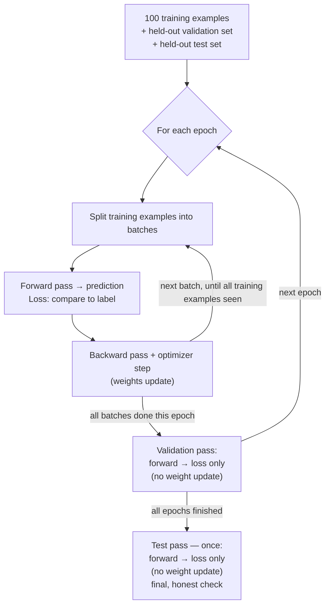

# Deep Learning Core Concepts

[Machine Learning Core Concepts](../machine-learning/core-concepts.md) ended at a boundary: classical ML relies on a human to design features; deep learning relies on the model learning its own features from raw data. This lesson picks up exactly there. It does not derive backpropagation or walk through every layer type — that depth lives in the *Explore Further* links below. What it covers is enough to read an architecture diagram and reason about a training run.

## Learning Objectives

- Explain what changes in the data pipeline when the input is raw (images, audio, text) instead of tabular

- Describe what happens in one iteration of a training loop, and how validation and test fit around it

- Read a loss curve and identify underfitting, overfitting, oscillating, diverging, and stalled training

- Choose a starting learning rate, batch size, and optimizer, and know which one to adjust from a loss curve

- Match an architecture family to a data structure and say why

## 1. The Data Pipeline Looks Different

A tabular ML pipeline mostly does encoding and scaling on columns that already exist. A deep learning pipeline works on raw signal, and the order matters: each sample is normalised and augmented individually before samples are ever grouped into a batch.

- **Normalisation of raw signal** — pixel values scaled to a fixed range, audio resampled to a fixed rate. This has to happen first: without it, training is unstable before the model has learned anything about the actual task.

- **Augmentation** — synthetic variation applied on the fly (crop, flip, adjust brightness for images; add noise, change pitch for audio) so the model does not just memorise the exact pixels or samples it was shown. Deep learning models need more of this than tabular models because raw data has far more redundant, position-dependent structure to exploit.

- **Batching** — only after individual samples are normalised (and, during training, augmented) do you group them. A `DataLoader` yields batches of a fixed size, shuffled each epoch, so the model sees varied gradients instead of memorising order.

## 2. What a Training Loop Does

Every pass — training, validation, or test — computes loss the same way: forward pass, then compare the prediction to the label. What differs is what happens *after*, and *how often* each one runs:

- **Forward pass** — the input goes through the network’s layers and produces a prediction.

- **Loss** — the same idea as in classical ML (cross-entropy, MSE), computed by comparing the prediction to the label.

- **Backward pass** — gradients of the loss with respect to every weight, computed automatically via backpropagation. You do not derive this by hand in practice; the framework does it.

- **Optimizer step** — weights move a small step against the gradient. Adam is the default that works in most situations; plain SGD with momentum is the classical alternative.

Training only ever touches the training split. **Validation runs inside the loop** — once at the end of every epoch, on data the weights were never updated against — which is exactly why it is a fair check on generalisation. **Test runs outside the loop** — once, only after every epoch is finished — matching the three-way split from [Machine Learning Core Concepts](../machine-learning/core-concepts.md) §1: train to learn, validation to tune against, test touched once at the very end.

One full pass over the training set (every training example seen exactly once) is an **epoch**. Unlike classical ML, where a model is often “fit” in one call, deep learning trains over many epochs, and you read the shape of the loss curve to know what to do next.

Here is that exact failure — training loss falling smoothly while validation loss follows for a while, then turns back up:

Validation loss tracks training loss through epoch 6, then separates and climbs back up — epoch 6 is where overfitting begins. Past that point, the model is no longer improving on data it has not seen; it is only memorising the data it has.

### Reading the Loss Curve

The chart above is one specific pattern. Here are the ones worth recognising on sight:

| Pattern | What you see | Likely cause | Typical fix |
|----|----|----|----|
| Underfitting | Both train and validation loss stay high, plateauing early | Model too simple, or not trained long enough | Increase model capacity, train longer, ease off regularization |
| Overfitting | Training loss keeps falling, validation loss stalls or rises (the chart above) | Model memorising the training data | More data, augmentation, dropout, early stopping |
| Rocky / oscillating | Loss jumps up and down with no smooth downward trend | Learning rate too high, batch size too small | Lower the learning rate, increase batch size, add a warmup schedule |
| Diverging / NaN | Loss grows without bound or becomes `NaN` | Exploding gradients, learning rate far too high | Gradient clipping, lower learning rate, check for a data scaling bug |
| Stalled / flat | Loss stops improving early, at a middling value, without oscillating | Learning rate too low, or the model has genuinely reached its ceiling | Try raising the learning rate first; if that doesn’t move it, question the architecture |

### Choosing Hyperparameters

**What training is actually trying to do.** The loss function is not just “a number” — it is a function of every weight and bias in the network at once. With millions of parameters, imagine a landscape with millions of dimensions; loss is the “height” at any point, and one specific setting of every weight and bias is one point in that space. Training is the search for a point where that height is low. The gradient (from the backward pass) points toward the steepest *increase* in loss at the current point; the optimizer step does the obvious thing and moves in the opposite direction — steepest decrease. That is the entire geometric meaning of the “optimizer step” bullet above.

This landscape is not one smooth bowl with a single lowest point, the way the picture above almost suggests — real ones are far higher-dimensional and rougher. There are shallow valleys (**local minima** — low points that are not the lowest possible), flat stretches (**plateaus** — where the gradient is near zero and progress stalls), and, in the very high-dimensional spaces real networks train in, **saddle points** (flat in some directions, steep in others) are actually a more common obstacle than true local minima. **Finding the exact global minimum is not the realistic goal** — the landscape is too large and irregular for that to be tractable. What you are actually searching for is a point good enough to generalise well.

That reframes what each hyperparameter below is for: not an arbitrary knob, but a specific way of controlling *this search*. Read the loss curve above before you tune — it tells you which one is actually wrong:

- **Learning rate** — the step size on this landscape at every move. Too high and you overshoot valleys entirely, producing the rocky or diverging patterns; too low and you crawl so slowly you look stalled on a plateau a bigger step would have crossed. A reasonable default is `1e-3` for Adam, then adjust based on what the curve is actually telling you.

- **Batch size** — how precisely each step’s direction is estimated. Larger batches give a smoother gradient estimate but cost more memory and can generalise slightly worse; smaller batches are noisier (sometimes that noise helps generalisation) but slower per epoch. A common range is 16–256, bounded by GPU memory.

- **Number of epochs** — how long you keep searching before accepting the point you have reached. Do not guess a fixed number. Use **early stopping**: stop once validation loss stops improving, rather than committing to a count in advance.

- **Optimizer** — Adam and SGD-with-momentum carry part of the previous step’s direction forward, which is exactly what lets the search roll through small bumps and shallow dips in the picture above instead of getting stuck the moment the gradient briefly points uphill. Adam is the default that works almost everywhere; SGD with momentum is the classical alternative — sometimes generalises better, usually needs more manual tuning to get there.

- **Regularization strength** (dropout rate, weight decay) — this is the lever for the overfitting row above.

- **Weight initialization** — the **starting point** on this landscape. A different starting point can lead to a different final minimum, which is part of why two training runs with identical code and data can still land on slightly different final loss values. Usually handled automatically by the framework’s defaults (Xavier/He init) — worth knowing it exists; not something you tune by hand at this level, see *Explore Further*.

Do not tune several hyperparameters at once on a hunch. Read the loss curve first — it tells you which one is actually wrong.

## Anatomy of a Network

Before naming architecture families, it helps to have the vocabulary for what any of them are actually built from. The example below is a dog-or-cat image classifier — concrete enough to show what actually flows in and out:

1.  **Input layer** — shaped to match your data. Here, the raw dog-or-cat photo.

2.  **Hidden layer** — where the computation happens; **depth** is how many of these are stacked.

3.  **Output layer** — shaped to match what you are predicting. Here, one unit per class.

4.  **Unit** — computes a weighted sum of its inputs plus a bias, then passes the result through an **activation function**.

5.  **Weight** — one connection between two units. This is exactly what training adjusts — a specific coordinate in the search from *Choosing Hyperparameters* above.

6.  **Output probabilities** — the output layer’s raw numbers turned into a probability per class (via softmax, for this multi-class task). 0.82 for Dog is not a guess presented as certainty — it is the model’s confidence, and the gap to 1.0 is real: some of the time, a model this confident is still wrong.

A few more things worth knowing about this structure:

- **Depth** and **width** (how many units per layer) both add capacity, but differently — depth composes simpler functions into more complex ones, width adds capacity within a single computation stage.

- The standard activation for hidden layers today is ReLU or GELU, not sigmoid or tanh — sigmoid and tanh saturate, and their gradients vanish across many stacked layers.

- The output layer’s shape and activation are fixed by the task, not a design choice: one unit with a sigmoid for binary classification, one unit per class with a softmax for multi-class classification, one linear unit (no activation) for regression.

- **The weights are the network’s only “knowledge.”** Training — the loop diagrammed above — is exactly the process of adjusting those weights. Nothing else about the network changes while it trains.

The layer *type* differs by architecture family — dense, convolutional, recurrent, attention-based — and that is what the table below covers. Every family still speaks the same layer/unit/weight/activation vocabulary from this section.

## 3. Architecture Families by Data Structure

You do not need to implement these from scratch. The right question is not “what kind of data is this” but “what structure does it have” — text can be a short sequence or a long one, and the same modality can call for different architectures depending on which.

| Structure | What it looks like | Architecture family | Why |
|----|----|----|----|
| Grid | A fixed spatial grid — pixels arranged in rows and columns | Convolutional Neural Networks (CNNs) | Convolution shares weights across spatial positions — a cat’s whisker looks the same whether it’s top-left or bottom-right |
| Graph | Nodes connected by edges, no fixed grid position — social networks, molecules, knowledge graphs | Graph Neural Networks (GNNs) | The relationships between nodes carry the information, not any fixed position — a CNN’s grid assumption does not apply |
| Short sequence | Order matters, but the sequence is short enough that recent context dominates — a sensor window, a short audio clip | RNN / LSTM | Processes one step at a time, carrying a memory of what came before — works well while the sequence is short enough that memory has not faded |
| Long sequence | Order matters, and something far back can still matter now — long text, long audio, high-resolution time series | Transformer / attention | Attention connects any two positions directly, avoiding the fading-memory problem an RNN hits over long sequences |

This table is intentionally shallow — [Computer Vision Overview](../computer-vision/overview.md) and [Speech AI Overview](../speech-ai/overview.md) go one level deeper into their respective families, and the terms below take you further than either.

## Explore Further

- **Architectures** — `ResNet`, `EfficientNet`, `Vision`` ``Transformer`` ``(ViT)`, `LSTM`, `GRU`, `attention`` ``mechanism`, `Transformer`, `Graph`` ``Neural`` ``Network`` ``(GNN)`

- **Training mechanics** — `learning`` ``rate`` ``schedule`, `warmup`, `mixed`` ``precision`` ``training`, `gradient`` ``clipping`, `batch`` ``normalization`, `dropout`, `weight`` ``initialization`` ``(Xavier,`` ``He)`, `local`` ``minimum`, `saddle`` ``point`, `loss`` ``landscape`

- **Tuning** — `hyperparameter`` ``search`, `grid`` ``search`, `Bayesian`` ``optimization`, `Optuna` — automated ways to search the space instead of hand-tuning

- **Transfer learning** — `fine-tuning`, `freezing`` ``layers`, `pretrained`` ``backbone`, `domain`` ``adaptation`

- **Beyond supervised learning** — this lesson (and [Machine Learning Core Concepts](../machine-learning/core-concepts.md)) only covers supervised learning. Also worth knowing: `unsupervised`` ``learning` (clustering, dimensionality reduction — no labels at all), `self-supervised`` ``learning` (labels manufactured from the data itself — the paradigm behind most LLM pretraining), `reinforcement`` ``learning` (learning from a reward signal via trial and error), `DPO`` ``(Direct`` ``Preference`` ``Optimization)` (a modern, simpler alternative to RLHF for aligning language models with human preferences), `federated`` ``learning` (training across decentralised data without ever centralising it)

- **Frameworks** — `PyTorch`, `torch.nn.Module`, `Dataset` / `DataLoader` (see [PyTorch quick reference](../cheatsheets/pytorch-quick-reference.md) for a hands-on starting point)

Curated starting points:

- [PyTorch official tutorials](https://docs.pytorch.org/tutorials/) — the most direct path from this lesson to working code

- [CS231n course notes (Stanford)](https://cs231n.github.io/) — the clearest free explanation of CNNs and the training loop mechanics

- [distill.pub](https://distill.pub/) — visual, intuition-first explanations of attention and related concepts (archive, but still the best of its kind)

## Review Questions

Discussion prompts for the weekly review — no single right answer, be ready to defend yours. The graded short quiz is at [Quiz](assessment/quiz.md).

1.  You’re training an image classifier and the training loss keeps dropping while validation loss starts climbing after epoch 8. What is happening, and what are two ways to address it?

2.  Why does an image augmentation pipeline typically do more than a tabular feature engineering pipeline?

3.  Your team has 300 labelled images of a rare defect type. Would you train a CNN from scratch or fine-tune a pretrained model? Justify it.

4.  What single piece of evidence would tell you your learning rate is set too high?

5.  A groupmate shows you a loss curve that bounces between 0.3 and 0.9 every few batches with no clear downward trend. What’s your first guess, and what would you try before touching anything else?

6.  Why does validation loss run inside the epoch loop while test loss runs outside it, only once? What would break if you swapped that around?
