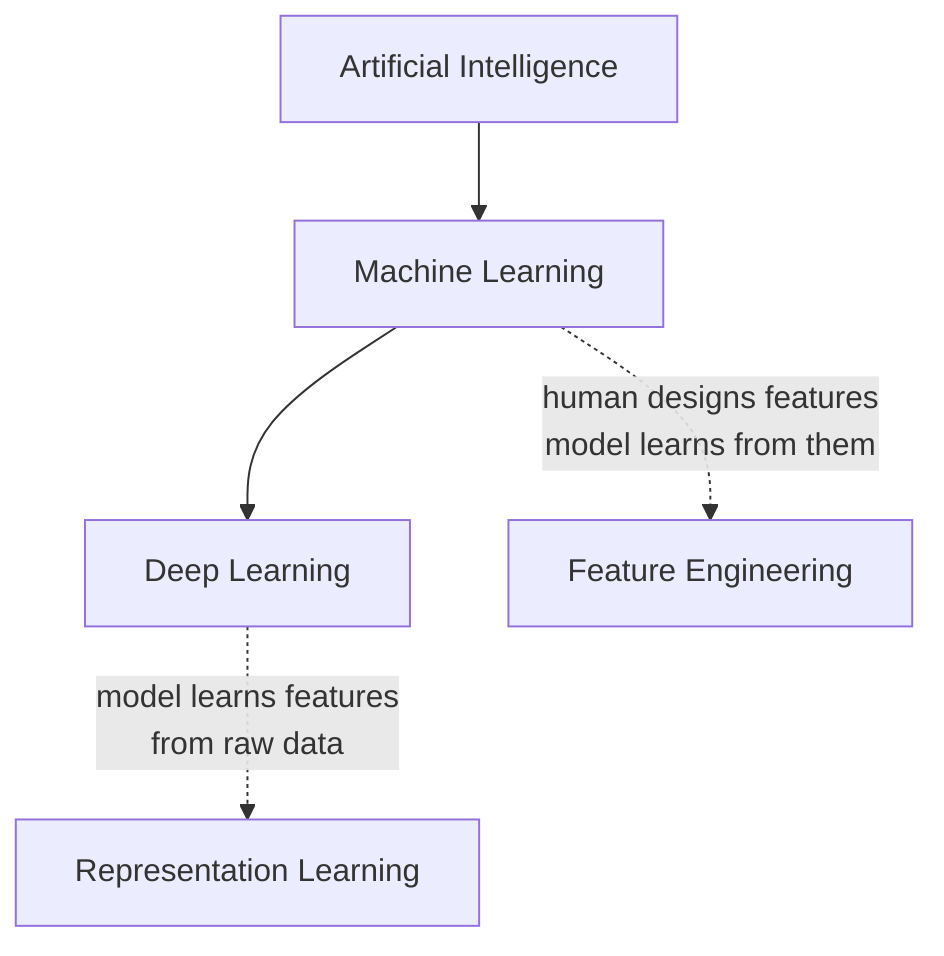

# Machine Learning Core Concepts

Classical machine learning is still the right answer for a large share of real problems — anything that arrives as a table of rows and columns, especially when you have thousands of examples rather than millions. This lesson covers the vocabulary and the judgement calls. It does not attempt to cover every algorithm; the *Explore Further* section at the end is where the breadth lives.

## Learning Objectives

- Distinguish features, labels, and the three data splits, and explain why the split strategy is a modelling decision

- Choose an evaluation metric that matches the problem, and state what that metric hides

- Name the main classical model families and say when each is a reasonable first choice

- Explain where classical machine learning ends and deep learning begins

## 1. The Shape of a Supervised Problem

Supervised learning means you have examples where the answer is known, and you want a function that generalises to examples where it is not.

- A **feature** is a measurable input value the model uses to make a prediction. It often starts life as a raw column, but just as often is derived from one — a ratio, a day-of-week pulled out of a timestamp, a count of orders in the last 30 days. A **label** is the answer you want predicted.

| Day | Gold Price Yesterday (\$/oz) | USD Index | Oil Price (\$/barrel) | Gold Price Today (\$/oz) |
|----|----|----|----|----|
| Mon | 2,015 | 103.2 | 78 | 2,022 |
| Tue | 2,022 | 103.5 | 79 | 2,018 |
| Wed | 2,018 | 102.9 | 76 | 2,031 |
| Thu | 2,031 | 103.1 | 80 | 2,027 |

The first three columns are **features** — values known before the outcome. `Gold`` ``Price`` ``Today` is the **label** — what the model is trained to predict. Each row is one training example.

- **Feature engineering** is the work of deriving those input values from raw data: encoding categories as numbers, scaling ranges so one value does not dominate, handling missing values, deriving a “days since last order” from two timestamps.

- The dataset splits three ways: **train** (the model learns from this), **validation** (you tune against this), **test** (you touch this once, at the end).

The split is not a formality. If your rows are not independent — multiple readings from the same machine, multiple invoices from the same vendor, measurements over time — a random split leaks information from train into test and your metrics become fiction. Group the split by the entity that repeats, or split by time when the data is temporal. Choosing the split correctly is a modelling decision, not a preprocessing step.

The related failure is **label leakage**: a feature that would not exist at prediction time, or that encodes the answer. A `refund_processed_date` column will predict “was refunded” with near-perfect accuracy and be worthless in production. If a model performs suspiciously well, look for leakage before celebrating.

## 2. Loss Is Not the Metric

Two different things get called “how good is the model”, and conflating them causes real confusion.

- The **loss function** is what the training algorithm minimises. It must be differentiable and it is computed on every example. Cross-entropy for classification, mean squared error for regression.

- The **evaluation metric** is what you and the business actually care about. It does not need to be differentiable. Precision, recall, F1, ROC-AUC, mean absolute error.

You optimise the loss and you are judged on the metric, and they can disagree.

Every metric below is computed from four numbers — how the model’s predictions land against the actual labels, together called the **confusion matrix**. The metric choice follows from the cost of each mistake:

| Metric | Answers | Use when |
|----|----|----|
| Accuracy | What fraction did I get right? | Classes are roughly balanced — otherwise it lies |
| Precision | Of the ones I flagged, how many were real? | False positives are expensive (spam filter, fraud freeze) |
| Recall | Of the real ones, how many did I catch? | False negatives are expensive (defect detection, disease screening) |
| F1 | Harmonic mean of the two | You need one number and both errors matter |
| ROC-AUC | How well does the model rank positives above negatives? | Comparing models, balanced-ish data |
| PR-AUC | Same, but ignores true negatives | Rare positive class — this is the one to use on imbalanced data |

**Accuracy on imbalanced data is the classic trap.** If 2% of products are defective, a model that predicts “fine” every time is 98% accurate and completely useless. This matters directly for the Computer Vision project in this track — defects are rare by construction.

For regression, MAE treats all errors equally while RMSE punishes large errors more; MAPE breaks when actual values approach zero.

### Worked Example

Suppose the defect-detection model above is tested on 100 products, 10 of which are actually defective:

Reading the numbers: TP = 8, FP = 5, FN = 2, TN = 85.

- Accuracy = (8 + 85) / 100 = **0.93**

- Precision = 8 / (8 + 5) = **0.62**

- Recall = 8 / (8 + 2) = **0.80**

- F1 = 2 × (0.62 × 0.80) / (0.62 + 0.80) ≈ **0.70**

93% accuracy looks strong — until you notice the model missed 2 of the 10 real defects (80% recall) and over a third of its defect alerts are false alarms (62% precision). This is exactly the trap named above, with real numbers behind it.

## 3. Model Families Worth Knowing

You do not need to derive these. You need to know what each assumes and when to reach for it.

| Family | Assumes | Reach for it when |
|----|----|----|
| Linear / logistic regression | The relationship is roughly linear | You need a baseline and an interpretable one |
| Decision tree | Data splits cleanly on thresholds | You want a rule set a human can read |
| Random forest | Many weak trees average out | Solid default, little tuning, hard to badly misuse |
| Gradient boosting (XGBoost, LightGBM) | Errors can be corrected iteratively | Tabular data where you want the best score — usually the winner |
| K-means | Clusters are roughly spherical, *k* is known | You have no labels and want structure |

Two ideas cut across all of them. **Overfitting** is when the model memorises training data and fails on new data — the signature is training performance far above validation performance. **Regularization** is any deliberate constraint that trades a little training accuracy for generalisation.

Always build a non-machine-learning baseline first: a threshold rule, the historical average, “predict the most common class”. If your model cannot beat it, the model is not the problem worth solving yet.

## 4. Where Classical ML Ends

The distinction that matters for this track:

- **Classical ML** — a *human* decides what the features are. Most of the skilled work is in feature engineering, and the model is comparatively simple.

- **Deep learning** — the network *learns* its own features from raw input: pixels, waveforms, characters. The skilled work moves to designing the data pipeline and choosing an architecture.

The trade-off is data and compute. Deep learning needs substantially more of both. On a table with a few thousand rows, gradient boosting will usually beat a neural network — and it will train in seconds on a laptop. Reach for deep learning when the input is raw perceptual data that has no natural columns.

**Everything in this lesson is about classical ML and tabular data.** Do not carry manual feature engineering into the computer vision work; [Deep Learning Core Concepts](../deep-learning/core-concepts.md) picks up exactly at that boundary.

## Explore Further

This lesson is a map, not the territory. These are the terms to search when your project needs them:

- **Imbalanced data** — `SMOTE`, `oversampling`, `undersampling`, `class`` ``weighting`, `threshold`` ``moving`. Note the standard warning: SMOTE is applied to the training split only, and it usually trades precision for recall.

- **Time series** — `stationarity`, `ARIMA`, `seasonal`` ``decomposition`, `lag`` ``features`, `walk-forward`` ``validation`. Temporal problems need a temporal split; a random split is always wrong here.

- **Validation** — `k-fold`` ``cross-validation`, `stratified`` ``split`, `grouped`` ``split`, `bias-variance`` ``tradeoff`

- **Pipelines** — `sklearn.pipeline.Pipeline`, `ColumnTransformer` — the standard way to make preprocessing reproducible and leak-free

Curated starting points:

- [scikit-learn User Guide](https://scikit-learn.org/stable/user_guide.html) — the reference for everything above, with worked examples

- [Google’s Machine Learning Crash Course](https://developers.google.com/machine-learning/crash-course) — free, ~15 hours, good on framing and metrics

- [Kaggle Learn: Intermediate Machine Learning](https://www.kaggle.com/learn/intermediate-machine-learning) — hands-on notebooks for pipelines, leakage, and boosting

## Review Questions

Discussion prompts for the weekly review — no single right answer, be ready to defend yours. The graded short quiz is at [Quiz](assessment/quiz.md).

1.  Your defect-detection dataset is 2% defective. A colleague reports 98% accuracy. What do you ask them next?

2.  You are predicting equipment failure from sensor readings taken every minute across 50 machines. Describe a split strategy that does not leak, and explain what a naive random split would do to your metrics.

3.  When would you deliberately ship a decision tree that scores worse than a gradient boosting model?

4.  Give an example of a feature in an invoice-processing dataset that would leak. How would you catch it?
