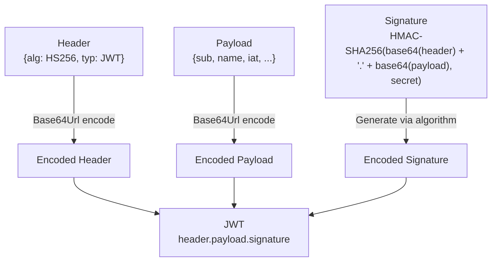

# API Mastery: REST & Security

## Introduction

In modern software development, APIs (Application Programming Interfaces) are the bridges that connect different software components. Whether you are building a mobile app, a web frontend, or a microservice architecture, the API is the backbone of your system.

While creating an API that “works” is relatively easy, designing one that is **scalable, secure, and easy to use** is a significant challenge. This guide covers the essential pillars of professional API development: RESTful design principles, solid security with JWT, robust Rate Limiting, and clear Documentation.

## RESTful API Design

REST (Representational State Transfer) is the most popular architectural style for web APIs. It relies on standard HTTP methods and status codes to manage resources.

### REST Principles

To thrive in the API world, you must understand these core principles:

1.  **Resource-Based**: APIs should expose “resources” (nouns), not actions (verbs).

    - **Bad**: `/getAllUsers`, `/createUser`

    - **Good**: `/users` (GET for list, POST for creation)

2.  **Statelessness**: The server should not store any client context between requests. Every request must contain all the information needed to process it (e.g., authentication tokens).

3.  **Uniform Interface**: Resources should be uniquely identified (URIs) and manipulated through standard representations (JSON).

### API Design Best Practices

- **Use Standard HTTP Methods**:

  - `GET`: Retrieve resources.

  - `POST`: Create a new resource.

  - `PUT`: Update a resource (full replacement).

  - `PATCH`: Update a resource (partial update).

  - `DELETE`: Remove a resource.

- **Return Correct Status Codes**:

  - `200`` ``OK`: Success (GET, PUT, PATCH).

  - `201`` ``Created`: Resource successfully created (POST).

  - `400`` ``Bad`` ``Request`: Invalid input.

  - `401`` ``Unauthorized`: Missing or invalid authentication.

  - `403`` ``Forbidden`: Authenticated but not allowed (permission issue).

  - `404`` ``Not`` ``Found`: Resource does not exist.

  - `500`` ``Internal`` ``Server`` ``Error`: Server blew up.

- **Versioning**: Always version your API to prevent breaking changes for clients.

  - Example: `/api/v1/products`

## Authentication & Authorization

Security is paramount. The modern standard for stateless API authentication is **JWT (JSON Web Tokens)**.

### JWT (JSON Web Tokens)

A JWT is a compact, URL-safe means of representing claims to be transferred between two parties. It consists of three parts separated by dots (`.`):

1.  **Header**: Algorithm & Token Type (e.g., `{"alg":`` ``"HS256",`` ``"typ":`` ``"JWT"}`).

2.  **Payload**: Data (Claims) about the user (e.g., `{"id":`` ``123,`` ``"role":`` ``"admin"}`).

3.  **Signature**: Verifies the token hasn’t been tampered with.

**The Flow:**

1.  User logs in with credentials.

2.  Server verifies credentials and returns a **signed JWT**.

3.  Client stores the JWT (e.g., in cookies).

4.  Client sends the JWT in the `Authorization` header (`Bearer`` ``<token>`) for subsequent requests.

5.  Server validates the signature and grants access.



**JWT components.**

### Refresh Tokens & Security Best Practices

**Why use a Refresh Token?** In a real-world application, keeping an Access Token valid for a long time (e.g., 1 week) is a security risk. If it’s stolen, the attacker has access for that entire week. However, asking the user to log in every 15 minutes is a bad user experience.

**The Solution: Access Token + Refresh Token**

1.  **Access Token**: Short-lived (e.g., 15 minutes). Used for API requests.

2.  **Refresh Token**: Long-lived (e.g., 7 days). Stored securely (e.g., HTTPOnly cookie). Used ONLY to get a new Access Token.

**The Flow with Refresh Tokens:**

1.  Client makes an API request with Access Token.

2.  If server returns `401`` ``Unauthorized` (Token Expired), client sends the Refresh Token to a special endpoint (e.g., `/auth/refresh`).

3.  Server validates the Refresh Token and issues a new Access Token.

4.  Client retries the original request with the new Access Token.

Security Tip **NEVER store sensitive data (like passwords or credit card numbers) in a JWT.** JWTs are **encoded** (Base64), not **encrypted**. Anyone can paste your token into [jwt.io](https://jwt.io) and read the payload. Only store non-sensitive identifiers like `user_id` or `role`.

### Implementation Example

Here is a simplified example using Python logic (conceptual):

``` python
import jwt
import datetime

SECRET_KEY = "my_super_secret_key"

def create_token(user_id):
    payload = {
        "user_id": user_id,
        "exp": datetime.datetime.utcnow() + datetime.timedelta(hours=1)
    }
    token = jwt.encode(payload, SECRET_KEY, algorithm="HS256")
    return token

def verify_token(token):
    try:
        payload = jwt.decode(token, SECRET_KEY, algorithms=["HS256"])
        return payload["user_id"]
    except jwt.ExpiredSignatureError:
        return "Token expired"
    except jwt.InvalidTokenError:
        return "Invalid token"
```

## Rate Limiting

### Why Rate Limiting?

Imagine a user (or a bot) sending 10,000 requests per second to your login endpoint. This could crash your database or slow down the service for everyone else.

**Rate Limiting** controls the number of requests a client can make within a specific timeframe (e.g., 100 requests per minute). It protects against:

- **DDoS Attacks**: Overwhelming the server.

- **Brute Force Attacks**: Guessing passwords.

- **Resource Starvation**: Ensuring fair usage for all users.

### Implementation Strategies

1.  **Fixed Window**: “100 requests per hour”. The counter resets at the top of the hour. Simple but can have “burst” issues at the window boundary.

2.  **Sliding Window**: Smoother approach, calculating the rate based on the last X minutes.

3.  **Token Bucket**: Analogy of a bucket filled with tokens at a constant rate. Each request costs a token. If the bucket is empty, the request is rejected (`429`` ``Too`` ``Many`` ``Requests`).

## API Documentation

Good code is useless if no one knows how to use it. Documentation should be comprehensive and up-to-date.

### OpenAPI / Swagger

**OpenAPI Specification (OAS)** is the industry standard for describing REST APIs. **Swagger UI** turns that specification into an interactive webpage where developers can test endpoints directly.

**Benefits:**

- **Automation**: Generate clients (SDKs) and server stubs automatically.

- **Interactivity**: Try out the API without writing code.

- **Clarity**: Defines exactly what request body is expected and what response will be returned.

### Example Specification (YAML)

``` yaml
openapi: 3.0.0
info:
  title: Sample API
  version: 1.0.0
paths:
  /users:
    get:
      summary: Returns a list of users
      responses:
        "200":
          description: A JSON array of user names
          content:
            application/json:
              schema:
                type: array
                items:
                  type: string
```


*API Spec Swagger Example.*

## API Security in 2026

### OWASP API Security Top 10 (2025)

The Open Worldwide Application Security Project maintains the most authoritative list of API vulnerabilities. Key risks for backend developers:

| \# | Risk | Description | Prevention |
|----|----|----|----|
| 1 | **Broken Object-Level Authorization** | User accesses another user’s data by changing an ID in the URL | Always verify the authenticated user owns the requested resource |
| 2 | **Broken Authentication** | Weak login flows, missing token validation | Use proven libraries (python-jose, passlib), short-lived tokens |
| 3 | **Broken Object Property-Level Authorization** | API returns sensitive fields the user should not see | Use Pydantic `response_model` to control which fields are exposed |
| 4 | **Unrestricted Resource Consumption** | No rate limits, unbounded queries | Rate limiting + pagination on all list endpoints |
| 5 | **Broken Function-Level Authorization** | Regular user accesses admin endpoints | Role-based access control on every route |
| 6 | **Server-Side Request Forgery (SSRF)** | API fetches attacker-controlled URLs | Validate and allowlist all outbound URLs |
| 7 | **Security Misconfiguration** | Debug mode in production, verbose errors | Disable debug, use environment-specific configs |
| 8 | **Lack of Protection from Automated Threats** | Bots abuse registration, scraping | CAPTCHA, rate limiting, abuse detection |

### CORS (Cross-Origin Resource Sharing)

CORS controls which domains can make API requests from a browser:

``` python
from fastapi.middleware.cors import CORSMiddleware

app.add_middleware(
    CORSMiddleware,
    allow_origins=["https://yourfrontend.com"],  # Never use ["*"] in production
    allow_credentials=True,
    allow_methods=["GET", "POST", "PUT", "DELETE"],
    allow_headers=["Authorization", "Content-Type"],
)
```

**Never set `allow_origins=["*"]` with `allow_credentials=True`** — this allows any website to make authenticated requests to your API on behalf of your users.

### Supply Chain Security

Third-party dependencies are a growing attack vector. Protect your API:

``` bash
# Python: Scan dependencies for known vulnerabilities
pip install pip-audit
pip-audit

# Pin exact versions in requirements.txt
pip freeze > requirements.txt

# Use lockfiles (uv.lock, poetry.lock) for reproducible builds
```

### Input Validation Checklist

Every API endpoint should validate:

**Type**: Is the input the expected type? (Pydantic handles this)

**Length**: Is string length within bounds? (`Field(max_length=255)`)

**Range**: Are numbers within acceptable range? (`Field(ge=0,`` ``le=10000)`)

**Format**: Does email/URL/date match expected format? (`EmailStr`, `HttpUrl`)

**Authorization**: Does the user have access to the referenced resource?

**Business rules**: Is the booking time in the future? Is the status transition valid?

------------------------------------------------------------------------

## Summary

Mastering APIs is about more than just moving data. It’s about designing systems that are predictable (REST), secure (JWT + OWASP), reliable (Rate Limiting), and usable (Documentation). Focus on these pillars, and you will build APIs that other developers love to use.

## References

- [REST API Tutorial](https://restfulapi.net/)

- [JWT.io Introduction](https://jwt.io/introduction)

- [OpenAPI Specification](https://swagger.io/specification/)

- [OWASP API Security Top 10 (2025)](https://owasp.org/API-Security/)

- [FastAPI Security Documentation](https://fastapi.tiangolo.com/tutorial/security/)

- [OWASP Secure Coding Practices](https://owasp.org/www-project-secure-coding-practices-quick-reference-guide/)

## Practice

### 🌐 Base URL

```
https://yourapp.com/backend-api/
```

------------------------------------------------------------------------

### 1. Core Endpoints

### **1.1 Generate Message (Send a Message)**

> **POST** `/backend-api/f/conversation` Used to send a message to the assistant and receive the generated response.

#### Request Body

``` json
{
  "user_id": "user_123",
  "conversation_id": "690d5b6c-02d8-8321-a91e-65ea55b781f7",
  "messages": [
    {
      "id": "msg_001", // If not specified, backend generates a new message ID
      "role": "user",
      "content": {
        "content_type": "text",
        "parts": ["Hello! Can you explain Redis caching?"]
      }
    }
  ],
  "metadata": {
    "temperature": 0.7
  }
}
```

**For Unique Id -\> Use uuid**

#### Response (Server-Sent Events Stream)

```
event: delta_encoding
data: "v1"

data: {"type": "resume_conversation_token", "token": "eyJhbGciOiJFUzI1NiIsInR5cCI6IkpXVCJ9...", "conversation_id": "690d5b6c-02d8-8321-a91e-65ea55b781f7"}

data: {"type": "input_message", "input_message": {"id": "msg_001", "author": {"role": "user"}, "create_time": 1762484546.479, "content": {"content_type": "text", "parts": ["Can you explain Redis caching?"]}, "status": "finished_successfully"}, "conversation_id": "690d5b6c-02d8-8321-a91e-65ea55b781f7"}

event: delta
data: {"o": "add", "v": {"message": {"id": "msg_002", "author": {"role": "assistant"}, "create_time": 1762484547.338, "update_time": 1762484547.817, "content": {"content_type": "text", "parts": [""]}, "status": "in_progress", "metadata": {"model_slug": "gpt-4-turbo-preview", "parent_id": "msg_001"}}, "conversation_id": "690d5b6c-02d8-8321-a91e-65ea55b781f7"}}

data: {"type": "message_marker", "conversation_id": "690d5b6c-02d8-8321-a91e-65ea55b781f7", "message_id": "msg_002", "marker": "user_visible_token", "event": "first"}

event: delta
data: {"v": [{"p": "/message/content/parts/0", "o": "append", "v": "Redis"}]}

event: delta
data: {"v": [{"p": "/message/content/parts/0", "o": "append", "v": " caching"}]}

event: delta
data: {"v": [{"p": "/message/content/parts/0", "o": "append", "v": " stores"}]}

event: delta
data: {"v": [{"p": "/message/content/parts/0", "o": "append", "v": " frequently"}]}

event: delta
data: {"v": [{"p": "/message/content/parts/0", "o": "append", "v": " used"}]}

event: delta
data: {"v": [{"p": "/message/content/parts/0", "o": "append", "v": " data"}]}

event: delta
data: {"v": [{"p": "/message/content/parts/0", "o": "append", "v": " in"}]}

event: delta
data: {"v": [{"p": "/message/content/parts/0", "o": "append", "v": " memory"}]}

event: delta
data: {"v": [{"p": "/message/content/parts/0", "o": "append", "v": " for"}]}

event: delta
data: {"v": [{"p": "/message/content/parts/0", "o": "append", "v": " fast"}]}

event: delta
data: {"v": [{"p": "/message/content/parts/0", "o": "append", "v": " access."}]}

event: delta
data: {"v": [{"p": "/message/status", "o": "replace", "v": "finished_successfully"}, {"p": "/message/end_turn", "o": "replace", "v": true}, {"p": "/message/metadata", "o": "append", "v": {"is_complete": true}}]}

data: {"type": "message_stream_complete", "conversation_id": "690d5b6c-02d8-8321-a91e-65ea55b781f7"}

data: [DONE]
```

#### 📖 SSE Stream Explanation

| Event Type | Purpose | Why It Matters |
|----|----|----|
| **`event:`` ``delta_encoding`** | Declares the streaming protocol version (`v1`) | Allows frontend to handle different streaming formats |
| **`resume_conversation_token`** | JWT token to resume/reconnect to this conversation stream | Enables connection recovery if stream is interrupted |
| **`input_message`** | Echoes back the user’s message that was just sent | Confirms message received and stored in DB |
| **`event:`` ``delta` (add)** | Creates a new assistant message with empty content and `status:`` ``"in_progress"` | Initializes the response container before streaming text |
| **`message_marker`** | Marks when the first visible token appears | Frontend can show “typing” indicator until this arrives |
| **`event:`` ``delta` (append)** | Streams individual text chunks (“Redis”, “ caching”, “ stores”…) | Creates the real-time typing effect by appending words progressively |
| **`event:`` ``delta` (replace status)** | Updates message status to `"finished_successfully"` and sets `end_turn:`` ``true` | Signals completion so frontend stops showing typing indicator |
| **`message_stream_complete`** | Confirms the entire message stream is done | Final acknowledgment that no more deltas are coming |
| **`[DONE]`** | Standard SSE termination signal | Closes the event stream connection |

#### 🔑 Key Concepts

**Delta Operations:**

- `"o":`` ``"add"` → Create new object

- `"o":`` ``"append"` → Add text to existing content

- `"o":`` ``"replace"` → Update a field value

- `"p":`` ``"/message/content/parts/0"` → JSON path to the field being updated

**Why Streaming?**

1.  **User Experience**: Shows progress immediately instead of waiting for full response

2.  **Perceived Performance**: Feels faster even if total time is the same

3.  **Long Responses**: User sees content as it generates (important for long answers)

4.  **Interruptible**: User can stop generation early if they got their answer

#### Notes

- If no `conversation_id` is provided → backend **creates a new one**.

- Each message (both user & assistant) is stored in the **messages** table.

- The backend can stream responses for real-time UI.

------------------------------------------------------------------------

### **1.2 List Conversations (Conversation History)**

> **GET** `/backend-api/conversations?offset=0&limit=20&order=updated` Returns a paginated list of all conversations for a user.

#### Response

``` json
{
  "items": [
    {
      "id": "690d5b6c-02d8-8321-a91e-65ea55b781f7",
      "title": "Redis Caching Explained",
      "last_message": "Redis caching stores frequently used data in memory...",
      "updated_at": "2025-11-07T09:30:00Z"
    },
    {
      "id": "732dd789-f512-7e01-b82e-13aa07b4e012",
      "title": "Python Decorators",
      "last_message": "A decorator wraps another function...",
      "updated_at": "2025-11-06T21:00:00Z"
    }
  ],
  "limit": 20,
  "offset": 0,
  "total": 2
}
```

#### Notes

- Query params (`offset`, `limit`, `order`, etc.) make it frontend-friendly.

- Can be cached with Redis:

  - Key → `user:{user_id}:conversation_list`

  - TTL → 10 min

------------------------------------------------------------------------

### **1.3 Get Conversation Detail**

> **GET** `/backend-api/conversation/{conversation_id}` Returns all messages inside a specific conversation.

#### Response

``` json
{
  "conversation_id": "690d5b6c-02d8-8321-a91e-65ea55b781f7",
  "messages": [
    {
      "id": "msg_001",
      "role": "user",
      "content": {
        "content_type": "text",
        "parts": ["Hello! Can you explain Redis caching?"]
      },
      "created_at": "2025-11-07T09:20:00Z"
    },
    {
      "id": "msg_002",
      "role": "assistant",
      "content": {
        "content_type": "text",
        "parts": [
          "Redis caching stores frequently used data in memory for fast access."
        ]
      },
      "created_at": "2025-11-07T09:22:00Z"
    }
  ]
}
```

#### Notes

- Ideal to cache full history:

  - Key → `conv:{conversation_id}:history`

  - TTL → 10 minutes

------------------------------------------------------------------------

### 2. Database Schema (SQLAlchemy Example Structure)

| Table | Purpose | Key Fields |
|----|----|----|
| **users** | Basic user info | `id`, `name`, `email` , `created_at` , `updated_at` |
| **conversations** | Chat sessions | `id`, `user_id`, `title`, `created_at` , `updated_at` |
| **messages** | Chat content | `id`, `conversation_id`, `role`, `content`, `created_at` , `updated_at` |

------------------------------------------------------------------------

### 3. Folder Layout (FastAPI-Style)

```
app/
├── main.py
├── api/
│   ├── routes/
│   │   ├── conversation.py    # /backend-api/f/conversation, /backend-api/conversations
│   │   └── message.py         # Optional
│   └── dependencies.py
├── core/
│   ├── config.py
│   ├── database.py
│   └── redis_client.py
├── models/
│   ├── user.py
│   ├── conversation.py
│   └── message.py
├── schemas/
│   ├── conversation.py
│   ├── message.py
│   └── user.py
└── services/
│   ├── ai_service.py          # LLM generation logic
│   ├── cache_service.py       # Redis operations
│   └── conversation_service.py # CRUD logic
```

------------------------------------------------------------------------

### 4. Request Flow Summary

1.  **Frontend** sends message via `POST`` ``/backend-api/f/conversation` → Backend validates input → fetches conversation → calls AI model → returns response.

2.  **Frontend** loads conversation list via `GET`` ``/backend-api/conversations?...` → Fetch from Redis cache → fallback to DB.

3.  **Frontend** loads conversation details via `GET`` ``/backend-api/conversation/{conversation_id}` → Return full history (cached or DB).

## Review Questions

1.  **Did you notice how standard HTTP methods like GET, POST, PUT, DELETE are used in the endpoints? Why is this important?**

    - A. It makes the API code run faster.

    - B. It allows the server to store more data.

    - C. It provides a predictable and uniform interface for developers.

    - D. It encrypts the user data automatically.

2.  **Which of the following HTTP status codes specifically indicates that a resource was successfully created?**

    - A. `200`` ``OK`

    - B. `201`` ``Created`

    - C. `204`` ``No`` ``Content`

    - D. `302`` ``Found`

3.  **In the context of REST APIs, what does “Statelessness” mean?**

    - A. The server does not remember the client state between requests; each request must contain all necessary info.

    - B. The server never stores data in a database.

    - C. The API does not have a fixed URL structure.

    - D. The client does not need to authenticate after the first login.

4.  **What is the primary difference between `PUT` and `PATCH`?**

    - A. `PUT` creates a resource, while `PATCH` deletes it.

    - B. `PUT` is used for partial updates, while `PATCH` replaces the entire resource.

    - C. `PUT` replaces the entire resource, while `PATCH` performs a partial update.

    - D. `PUT` is secure, while `PATCH` is not.

5.  **Which component of a JWT ensures that the token has not been tampered with?**

    - A. The Header

    - B. The Payload

    - C. The Signature

    - D. The Expiration Claim (`exp`)

6.  **If a JWT is stolen, what is the most effective immediate mitigation if “Refresh Tokens” are NOT used?**

    - A. Change the user’s password.

    - B. There is no immediate way to revoke a stateless JWT without server-side tracking (blocklist) or waiting for expiration.

    - C. Delete the user account.

    - D. Change the API URL.

7.  **What is the difference between specific `401`` ``Unauthorized` and `403`` ``Forbidden` status codes?**

    - A. They are interchangeable.

    - B. `401` means the server is down, `403` means the database is full.

    - C. `401` indicates missing or invalid authentication credentials; `403` indicates the user is authenticated but lacks permission.

    - D. `401` is for client errors, `403` is for server errors.

8.  **Which HTTP method is considered “Idempotent” (safe to retry multiple times without changing the result beyond the initial application)?**

    - A. `POST`

    - B. `PUT`

    - C. `PATCH` (usually, but not strictly required)

    - D. All of the above are always idempotent.

9.  **Why is it critical to use HTTPS when using Basic Auth or Bearer Tokens (JWT)?**

    - A. HTTPS increases the speed of the API.

    - B. HTTPS prevents “Man-in-the-Middle” attacks where the token could be intercepted in plain text.

    - C. HTTPS compresses the JSON response.

    - D. It is not critical; HTTP is fine for internal tools.

10. **How does Rate Limiting protect an API?**

    - A. It validates the schema of the JSON body.

    - B. It prevents abuse (DoS/DDoS) and ensures fair usage by limiting requests per client over time.

    - C. It encrypts the database connection.

    - D. It ensures that only admin users can access the API.

11. **When designing a REST API, when should you use Query Parameters (e.g., `/users?role=admin`) vs Path Parameters (e.g., `/users/123`)?**

    - A. Always use Query Parameters for everything.

    - B. Use Path Parameters for filtering and sorting, and Query Parameters to identify specific resources.

    - C. Use Path Parameters to identify a specific resource, and Query Parameters for filtering, sorting, or pagination.

    - D. Use Path Parameters for secrets (like passwords) and Query Parameters for public data.

12. **What is a “Cross-Origin Resource Sharing” (CORS) error?**

    - A. An error when the database and server are on different time zones.

    - B. A browser security feature preventing a web page from making requests to a different domain than the one that served the page.

    - C. An error when two users try to edit the same file at the same time.

    - D. The API server running out of memory.

**View Answer Key**

1.  **C** - Uniform Interface is a key REST constraint.

2.  **B** - 201 is the specific code for creation.

3.  **A** - Statelessness enables scalability by removing server-side session storage requirements.

4.  **C** - PUT is full replacement; PATCH is partial modification.

5.  **C** - The signature is generated using a secret key to verify integrity.

6.  **B** - Pure stateless JWTs cannot be revoked easily; short expiration or blocklists are needed.

7.  **C** - 401 = “Who are you?”; 403 = “I know who you are, but you can’t do this.”

8.  **B** - PUT requests result in the same state regardless of how many times they are sent. POST is NOT idempotent.

9.  **B** - Tokens are sent in the header; without HTTPS, anyone sniffing the network can read them.

10. **B** - Rate limiting restricts volume to prevent overload.

11. **C** - Path = Identity; Query = Modifiers/Filters.

12. **B** - CORS is a browser-enforced security boundary.
