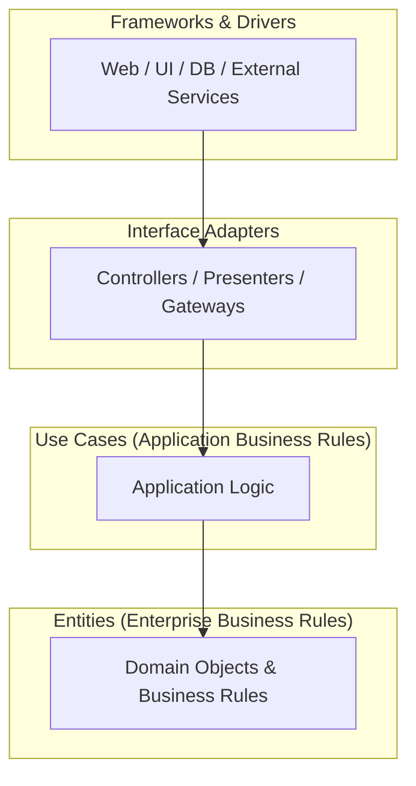
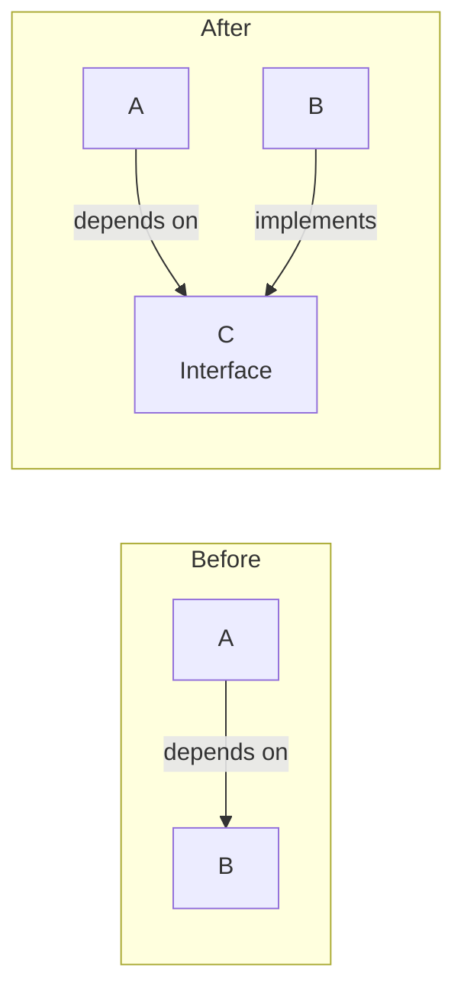
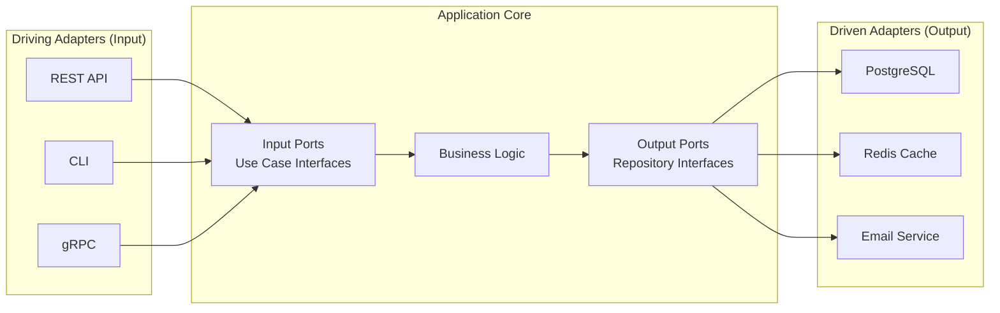

# Clean Architecture & Layering

## Foreword

As developers, we’re always told to stay up-to-date and learn new things. But then we run into old code that’s about as flexible as petrified wood. 🪵 Enter Robert Cecil Martin, or “Uncle Bob” with his Clean Architecture! 💪

When I initially came across this, I decided to use the same approach that I have been following in my Design Pattern class, since this too seemed like a really popular design pattern. I took an existing implementation and tried to match it with the concepts I learn. I soon found out that this wasn’t gonna work here. Gotta come up with something else. So I decided to try another approach. I had read somewhere that to truly understand a concept, I had to answer the 5 ‘W’s and an ‘H’. The What, Why, Who, Where, When and How. I already mentioned the Who, and in this case, the When and Where is not important. So in this blog, we’ll see:

- What is Clean Architecture?

- How does it work?

- Why go through all that trouble?

## What?

Clean Architecture revolves around a simple idea. Structuring your code in the form of layers, with each layer having its specific purpose (Single Responsibility Principle or SRP). It starts from the inner layer and gradually moves out towards the outermost layer. In Clean Architecture, the dependencies move inward. This means that the outer layers are dependent on the layer directly below them, but the inner layers do not depend on any of the outer layers. Hence, the innermost layer does not depend on anything.

Think of it like an onion.🧅 With outermost layers that can easily be peeled off, without damaging any of its insides. Similarly, in Clean Architecture, the outermost layers are the ones that change most frequently, but since none of the inner layers depends on it, they can easily be swapped out and replaced.

If you found this analogy confusing, maybe you will better understand the one from pusher.com where they tie objects with tangled strings and try to replace one of them (the scissors).


### A dependency mess

As you can see in the picture above, replacing the scissors without disturbing any of the others is difficult. But, if we re-structure it into something like:


### The mess ‘managed’ centrally

Now, we can just take the string attached to the scissors out from under the Post-it box, and put another one in there. None of the others will be disturbed. Here it seems as if all entities are related to a single central entity, however, that is not necessary for Clean Architecture.

The actual representation of it, as proposed by “Uncle Bob” includes 4 concentric circles, a diagram which you would be familiar with if you had even tried to read about the architecture before.



### Uncle Bob’s Clean Architecture diagram

Here, as discussed earlier, are 4 layers, with the arrows representing dependencies. We don’t necessarily need to have 4 layers, we can have fewer, or more depending on the scale and complexity of our application. Next, we will look at each layer and discuss what it could contain.

### Entity

The entity layer is at the lowest level of abstraction and is the backbone of your entire system. It does not depend on any other layer, and houses entities that are the fundamental building blocks of the application. Abstract things like classes, interfaces etc. make up this layer.

For example, if we have a User class or a post interface, it should not be dependent on any other logic of the software like the Database or Framework used or any other logic in the code. Similarly, only things in the “use case” layer should be dependent directly on the “entity” or “domain” layer. Now what exactly lies in the “use case” layer?

### Use Case

The use case layer is where all the important business logic of your application lives. Think of it as the master chef who takes raw ingredients and creates a delicious meal. 🍳👨‍🍳 In this case, the raw ingredients are the request data received from the controller layer, and the meal is the object created from that data.

For example, if you want to register a new user, the use case layer takes the request data and creates a user object from it. Once the object is created, it passes it on to the infrastructure layer, which handles the database implementation to store it.

So, the use case layer is like the middleman between the controller and infrastructure layers, ensuring that all the business logic is properly executed and implemented.

### Controller

The controller layer is like the traffic cop of your application.🚦 It’s responsible for managing the flow of incoming requests and directing them to the appropriate destination. Just like a traffic cop, the controller layer needs to be quick and efficient, making sure that each request is properly validated and passed on to the right place. It is also responsible for adapting the incoming request data, and parsing and validating it for further use. So if the incoming data is of invalid format like if someone put an invalid date (to say they were born in 1894 😉), then the error would not propagate further, and an error response would be sent back.

### Infrastructure

The infrastructure layer is mainly responsible for storing and retrieving data from the database. 📚 Think of it as the librarian, who makes sure that each piece of information is properly organized and easy to access. It sometimes also interacts with external services like payment gateways or email providers.

### Outermost

The outermost layer typically consists of the UI. So for a back-end developer, the controller is the outermost implementation. The UI built by the front-end developer is the outermost in most cases. Like the peel of the Clean Architecture onion. 🧅

#### Become a member

All the inner layers are independent of it. The back end could receive requests from a Web App, a Mobile app, or even something like Postman, it would work the same in all cases.

## How?

Another question that might arise is: if the use case implements business logic to for example add a user to the database, then doesn’t this inherently mean that the use case would depend on the database or infrastructure layer? How do we fix that? We say that the use case implements logic but it doesn’t depend on the database, or the framework used for getting the data to perform that logic. How exactly is that possible?

Well, the actual implementation we’ll hopefully see in upcoming blogs, but we can discuss the logic behind it here. In the example above, yes the use case depends on the other layers. But that’s where a concept called dependency inversion comes into the picture. It is here to turn the tables (or dependencies) and invert them to our favourable direction (inwards rather than outwards).

### Dependency Inversion 🔃

Dependency Inversion is one method that is key to implementing Clean Architecture. Suppose we have 2 entities: A and B. Let’s say A depends on B, but we want it the other way around. In that case, we can introduce an abstract interface C between them to act as an Uno Reverse Card. 🔃



I have tried to illustrate what I am saying in the picture above. Here, initially, Entity A depended on another Entity B. To invert this dependency, we introduced an interface C, which enforces the format of output that is accepted by A. So no matter what the inside logic is, if any entity follows this interface, then it can be used by A to perform its task. Hence, A no longer depends specifically on B, but B has to comply with the rules accepted by A. Hence, B has now become dependent on A. Now, if A was the use case and B was a database connection like Postgre, that can easily be replaced as long as the newer implementation fulfils the format enforced by C.

So now if the application scales up and the data becomes so highly relational that a relational database like Neo4j would be more feasible, the only changes required would be within B.

As long as the output implements C, we can even feed a stub instead of C for testing purposes. 🧪

Congrats! 🥳 Your code is now highly flexible 🤸, maintainable, testable and modular!

Go ahead! show off all this jargon and impress some clients! 😎

Next, we’ll see another method for solving dependency conflicts called dependency injection.

### Dependency Injection 💉

Dependency Injection to resolve dependency conflicts involves passing the dependency from an external source, rather than importing it first-hand. Like when you buy a remote, it depends on the batteries to work. When TV companies include the batteries with the remote, they inject that dependency, so that you don’t explicitly have to import (buy) them. This is an effective technique used to decouple code in Clean Architecture.

With this, one layer could call a method in another layer, without actually knowing about the concrete implementation within that layer. A common way to achieve this is by passing an object of the other layer into the parameters of methods of the first layer. The dependent layer could then call the methods of that object without worrying about the concrete implementation.


Hence, whenever we decide to upgrade the code of the dependency, as long as the method names are the same and they provide similar functionality, any dependent layer can call those methods and continue working as before. This could also help stub out the dependency for testing purposes. For example: shifting to a local in-memory database for testing.

## Why?

Ok. Now that we know the What and How of Clean Architecture, it’s high time we asked Why? Why go through the whole process of implementing such a sophisticated architecture?

For starters, the number one aspect of development that a lot of people seem to forget quite often:

> YOU’RE NOT THE ONLY ONE WORKING ON THAT CODE!!!  
> Literally every good developer ever

A modular code can help teamwork as you don’t have to worry about what the other team members are doing or how you should change your code to support their implementation. You could simply focus on your part of the project, or “your layer”.

Second, as I pointed out throughout the article, your code becomes easier to test. You can easily stub out parts of the code as and when required.

Third and most important: Nothing stands the test of time! ⏱ We are not alien to deprecated dependencies and legacy code that is no longer maintained. Hence, proper implementation of Clean Architecture obviates the arduousness of migrating or upgrading \~~if\~~ when required. I hope that’s enough reason for those building large, scalable projects that they hope to maintain for a long time.

Another concern is for the small-scale projects that even if deployed, will not be for handling a lot of users or data. Things like portfolio pages, simple CRUD apps made for learning and exploring, etc. These projects might never leverage the full potential of Clean Architecture in their lifetime. Hence, it would be redundant rather than optimal for such smaller projects.

Remember, Clean Architecture is not a silver bullet. It’s not a set of rules that you must follow blindly, rather it’s a set of guidelines that you can adapt and adjust to fit your specific needs and requirements.

So, one should always consider the scale and purpose of their projects before deciding what technologies and approaches to employ.

## Architecture Patterns in 2026

Clean Architecture is one of several related patterns. Understanding the landscape helps you choose the right approach:

### Modular Monolith (Recommended Starting Point)

The 2026 consensus among backend architects: **start with a Modular Monolith** before considering microservices. It delivers 80% of microservices benefits at 20% of the cost.

```
monolith/
├── modules/
│   ├── users/          # Self-contained module
│   │   ├── routes.py
│   │   ├── service.py
│   │   ├── repository.py
│   │   └── models.py
│   ├── tickets/        # Another self-contained module
│   │   ├── routes.py
│   │   ├── service.py
│   │   ├── repository.py
│   │   └── models.py
│   └── shared/         # Shared kernel (minimal)
│       └── auth.py
├── main.py             # Composes all modules
└── database.py         # Single database (for now)
```

**Key rules:**

- Modules communicate through well-defined interfaces, not by importing each other’s internals

- Each module owns its own database tables (even if they share the same physical database)

- If you later need to extract a module into a microservice, the interface is already clean

### Hexagonal Architecture (Ports and Adapters)

A pattern closely related to Clean Architecture, emphasizing explicit boundaries:



### Architecture Decision Guide

| Your Situation | Recommended Pattern |
|----|----|
| Small team (\< 10), single product | **Modular Monolith** |
| Complex business domain, many rules | **Hexagonal Architecture** |
| Need independent deployments per team | **Microservices** |
| Simple CRUD app, prototype | **Layered (MVC)** — don’t over-engineer |
| Learning/exploring | **Clean Architecture** for understanding principles |

------------------------------------------------------------------------

## References

- [Clean Architecture — Robert C. Martin](https://blog.cleancoder.com/uncle-bob/2012/08/13/the-clean-architecture.html)

- [Hexagonal Architecture — Alistair Cockburn](https://en.wikipedia.org/wiki/Hexagonal_architecture_(software))

- [Modular Monolith — Kamil Grzybek](https://www.kamilgrzybek.com/blog/posts/modular-monolith-primer)

- [Backend Architecture Patterns — Codelit.io (2026)](https://codelit.io)

## Practice

### Exercise 1: Identify the Layers

Given this FastAPI project structure, classify each file into the correct Clean Architecture layer (Entity, Use Case, Controller, Infrastructure):

```
app/
├── main.py
├── routers/
│   └── users.py          # FastAPI route definitions
├── services/
│   └── user_service.py   # Business logic for user operations
├── models/
│   └── user.py           # SQLAlchemy ORM models
├── schemas/
│   └── user.py           # Pydantic request/response models
├── repositories/
│   └── user_repository.py  # Database queries
└── database.py           # Database connection setup
```

**Tasks:**

1.  Map each file to a Clean Architecture layer. Justify your classification.

2.  Draw the dependency arrows between layers. Do any dependencies violate the Dependency Rule (dependencies must point inward)?

3.  If `user_service.py` imports `user_repository.py` directly, how would you apply Dependency Inversion to fix this?

### Exercise 2: Refactor to Clean Architecture

Below is a “big ball of mud” FastAPI endpoint that mixes all concerns. Refactor it into proper layers:

``` python
# BAD: Everything in one function
@app.post("/users")
async def create_user(name: str, email: str, db: Session = Depends(get_db)):
    # Validation (should be in schema/controller layer)
    if not email or "@" not in email:
        raise HTTPException(status_code=400, detail="Invalid email")

    # Business logic (should be in use case layer)
    existing = db.query(UserModel).filter(UserModel.email == email).first()
    if existing:
        raise HTTPException(status_code=409, detail="Email already registered")

    # Database operation (should be in infrastructure/repository layer)
    hashed_pw = hash_password("default123")
    user = UserModel(name=name, email=email, password=hashed_pw)
    db.add(user)
    db.commit()
    db.refresh(user)

    # Response formatting (should be in controller layer)
    return {"id": user.id, "name": user.name, "email": user.email}
```

**Deliverables:**

1.  Create separate files: `schemas/user.py`, `services/user_service.py`, `repositories/user_repository.py`, `routers/users.py`

2.  Define an abstract interface (protocol) for the repository

3.  Show how the router calls the service, and the service calls the repository through the interface

### Exercise 3: Dependency Injection Swap

Using the Dependency Inversion principle, create two implementations of a `NotificationService`:

1.  `EmailNotificationService` — sends real emails (production)

2.  `FakeNotificationService` — logs to console (testing/development)

Show how FastAPI’s `Depends()` system lets you swap between them without changing any business logic code.

## Review Questions

1.  **What is the Dependency Rule in Clean Architecture?**

    - *Hint*: Think about which direction dependencies are allowed to flow between layers.

2.  **Explain the difference between Dependency Inversion and Dependency Injection. How do they relate to each other?**

    - *Hint*: One is a principle (from SOLID), the other is a technique. How does the technique implement the principle?

3.  **Why does Clean Architecture place business logic (use cases) in an inner layer that has no dependencies on frameworks or databases?**

    - *Hint*: Think about what happens when you need to swap PostgreSQL for MongoDB, or Flask for FastAPI.

4.  **A junior developer argues: “Clean Architecture is overkill for our small CRUD app.” Is this a valid argument? When would you agree or disagree?**

    - *Hint*: Consider the scale, team size, expected lifetime, and complexity of the project.

5.  **In a Clean Architecture project, where should Pydantic schemas (request/response models) live? Why?**

    - *Hint*: Pydantic schemas are “interface adapters” — they translate between the outside world (HTTP) and the inner layers (use cases/entities).

6.  **How does Clean Architecture improve testability? Give a concrete example.**

    - *Hint*: Think about how Dependency Inversion lets you replace a real database with an in-memory fake for testing.
