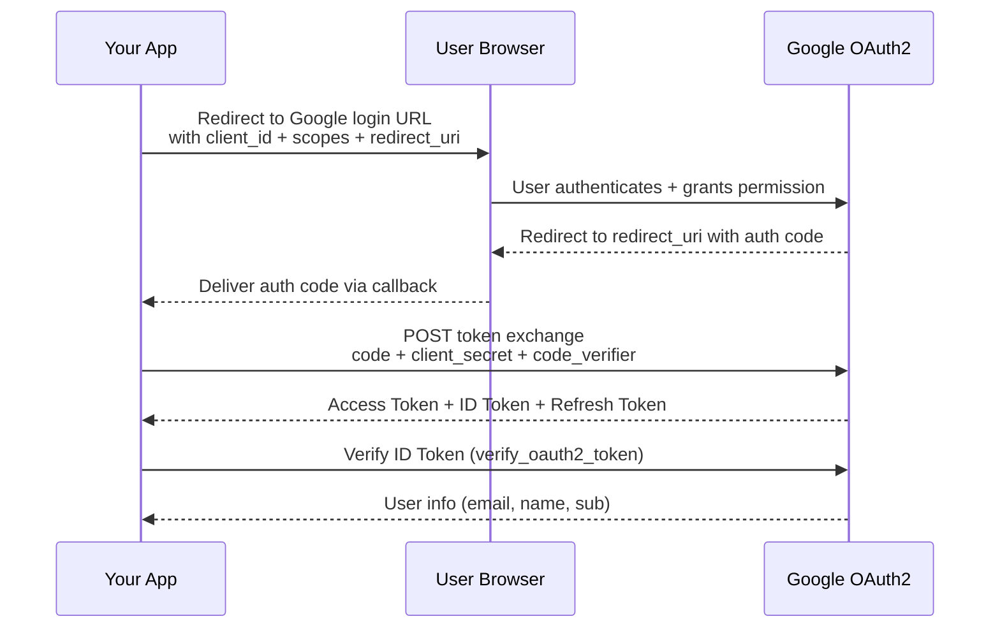
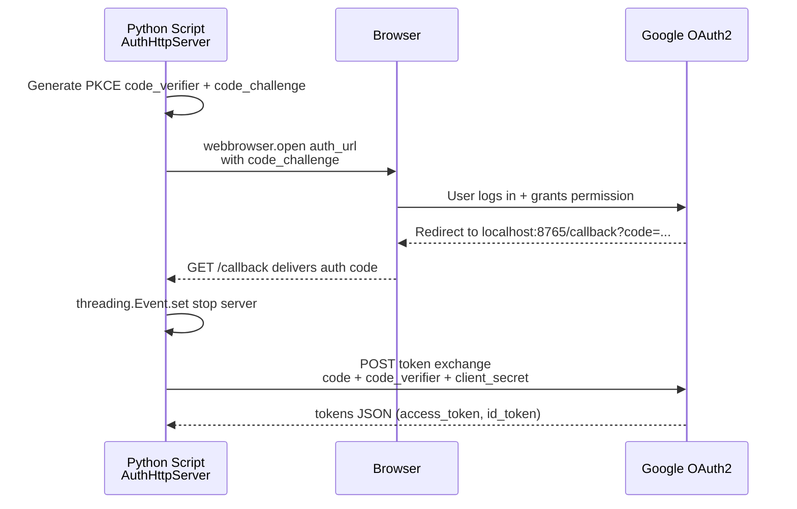

# Google OAuth2 Authentication



## Install required packages

``` sh
pip install google-auth-oauthlib google-auth
```

## Create a Google OAuth Client

1.  Go to <https://console.cloud.google.com/apis/credentials>

2.  Click Create Credentials → OAuth client ID

3.  Choose Desktop App

4.  Download the JSON file (e.g., `client_secret.json`)

5.  Put the file in your working directory.


## Minimal Working Code Using `google-auth-oauthlib`

This code:

- Opens Google login in your browser

- User logs in

- Google redirects back to a local server

- Code retrieves the tokens

``` python
from google_auth_oauthlib.flow import InstalledAppFlow

SCOPES = [
    "openid",
    "https://www.googleapis.com/auth/userinfo.profile",
    "https://www.googleapis.com/auth/userinfo.email",
]

CLIENT_SECRET_FILE = "client_secret.json"

flow = InstalledAppFlow.from_client_secrets_file(
    CLIENT_SECRET_FILE, SCOPES
)

# Run local server — this opens the Google login page
credentials = flow.run_local_server(port=8080)

print("Access Token:", credentials.token)
print("ID Token:", credentials.id_token)
print("Refresh Token:", credentials.refresh_token)
print("User logged in successfully!")
```

## Extract User Info

``` python
from google.oauth2 import id_token
from google.auth.transport import requests

request = requests.Request()

user_info = id_token.verify_oauth2_token(
    credentials.id_token,
    request,
    audience=flow.client_config['client_id']
)

print(user_info)
# {'iss': 'https://accounts.google.com', 'email': '[email protected]', 'name': 'Name', ...}
```

## Implementing the OAuth2 Flow Manually

To understand how Google OAuth2 works, here is an implementation of the local callback server without the `InstalledAppFlow` library.



``` python
import webbrowser
import http.server
import socketserver
import threading
from urllib.parse import urlparse, parse_qs, urlencode
import urllib

import base64
import os
import json
import hashlib

import requests


class Handler(http.server.SimpleHTTPRequestHandler):
    def do_GET(self):
        query = urlparse(self.path).query
        params = parse_qs(query)

        if "code" in params:
            self.server.shared_data['auth_code'] = params["code"][0]
            self.send_response(200)
            self.end_headers()
            self.wfile.write(b"Authorization received. You can close this tab.")
            self.server.event.set()
        else:
            self.send_response(400)
            self.end_headers()
            self.wfile.write(b"No authorization code found.")


class AuthHttpServer(socketserver.TCPServer):
    AUTH_URL = "https://accounts.google.com/o/oauth2/v2/auth"
    TOKEN_URL = "https://oauth2.googleapis.com/token"

    def __init__(self, server_address, client_secret_filepath):
        super().__init__(server_address, Handler)
        with open(client_secret_filepath, "r") as f:
            data = json.load(f)

        self.client_id = data["installed"]["client_id"]
        self.client_secret = data["installed"]["client_secret"]

        self.shared_data = {}
        self.event = threading.Event()
        self.code_verifier, self.code_challenge = self._generate_pkce()

        self._redirect_uri = f"http://{server_address[0]}:{server_address[1]}/callback"

    def _generate_pkce(self):
        code_verifier = base64.urlsafe_b64encode(os.urandom(40)).rstrip(b'=').decode('utf-8')
        code_challenge = base64.urlsafe_b64encode(
            hashlib.sha256(code_verifier.encode('utf-8')).digest()
        ).rstrip(b'=').decode('utf-8')
        return code_verifier, code_challenge

    def start_server(self):
        socketserver.TCPServer.allow_reuse_address = True
        with self as server:
            server.handle_request()

    def auth(self, extract_auth_code=True):
        params = {
            "response_type": "code",
            "client_id": self.client_id,
            "redirect_uri": self._redirect_uri,
            "scope": "openid email profile",
            "code_challenge": self.code_challenge,
            "code_challenge_method": "S256",
            "access_type": "offline",
            "include_granted_scopes": "true",
        }
        auth_url = AuthHttpServer.AUTH_URL + "?" + urllib.parse.urlencode(params)

        webbrowser.open(auth_url, new=1)

        thread = threading.Thread(target=self.start_server)
        thread.start()

        self.event.wait()

        if extract_auth_code:
            return requests.post(AuthHttpServer.TOKEN_URL, data={
                "code": self.shared_data['auth_code'],
                "client_id": self.client_id,
                "code_verifier": self.code_verifier,
                "client_secret": self.client_secret,
                "redirect_uri": self._redirect_uri,
                "grant_type": "authorization_code",
            }).json()

        return self.shared_data['auth_code']


auth_server = AuthHttpServer(("localhost", 8765), client_secret_filepath="client_secret.json")
result = auth_server.auth()
print(result)
```

## Comparison: Library vs Manual Implementation

| Aspect | Manual (`AuthHttpServer`) | `InstalledAppFlow` |
|----|----|----|
| OAuth flow handled | Manually build auth URL, start local server, capture code, exchange tokens | Fully handled by the library |
| PKCE handling | Explicitly generate `code_verifier` and `code_challenge` | Automatically handled |
| HTTP requests | Use `requests.post` to get tokens | Library internally requests token and creates a `Credentials` object |
| Local server | Manually run a server with `http.server` | `flow.run_local_server()` spins up a temporary server automatically |

**Summary:** `InstalledAppFlow` saves significant boilerplate. Don’t manually generate PKCE or parse query strings unless you need fine-grained control.
